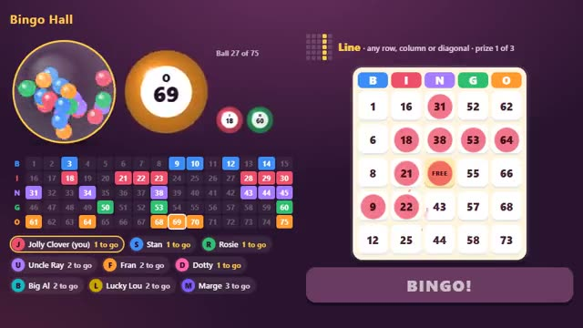

# Bingo Hall

Eyes down! Daub fast, shout BINGO first. A multiplayer starter game from [Multiplayer Agent](https://multiplayeragent.com): 2D, drop-in, 2–30 players, with bots that fill empty seats.

## How it plays

The caller draws a ball every few seconds: tap it on your card to daub it. Finish a line, then the four corners, then a full house, and hit BINGO before anyone else.

**Controls:** Click or tap numbers to daub, click or tap BINGO (or press B).

## Make it yours in the Game Builder

Open the [Game Builder](https://multiplayeragent.com), choose **Start from a starter game** and pick Bingo Hall. It opens as version 1 in your studio, ready to play and publish. Then ask for changes, for example:

- Make it a spooky Halloween bingo with pumpkin daubers
- Add an X-shaped prize after the four corners
- Give each player two cards to play at once

## Run it yourself

1. Get a free publishable key (`pk_…`) at [multiplayeragent.com](https://multiplayeragent.com).
2. In `index.html`, put it in place of `pk_REPLACE_ME` in the `MP_CONNECT` block.
3. Open `index.html` in a browser. No build step and no server needed.

Without a key it still runs, offline against bots.

## How it is built

- One `index.html`. The comment at the top of the script maps the code and explains the multiplayer.
- **Leaderboard:** Prizes won, all time, shown on the results card.
- **Bots:** Bots take the empty seats, daub at a human pace and sometimes win.
- **Host-run rounds:** The host's browser calls the balls and checks every BINGO; if it leaves, the next player takes over.
- **Live sync:** Everyone sees the same balls, cards and who is close to a bingo.
- `?attract` runs it offline with bots only. The preview video is recorded from it.

## License

MIT.
